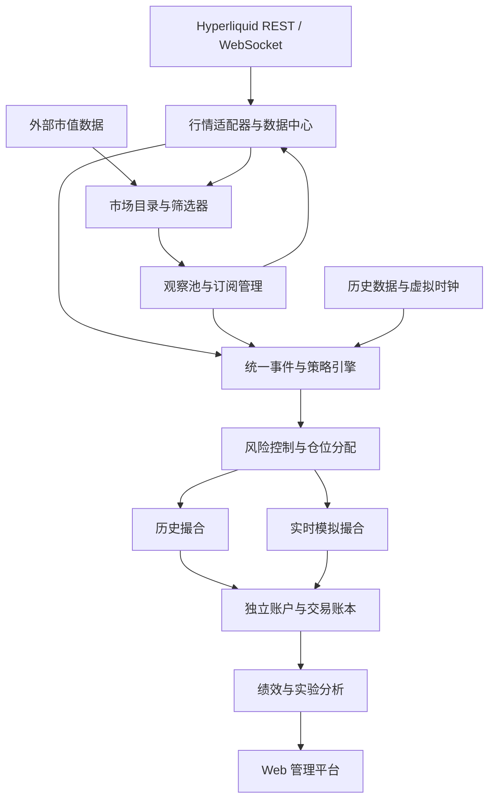

# Hyperliquid 量化交易研究与自动交易平台

**版本：V1.0｜状态：开发需求基线｜目标读者：Codex / 开发人员**

## 1. 项目目标与边界

建设一个可长期扩展的 Hyperliquid 量化研究平台（HL Quant Lab），实现全市场发现、手动及自动选币、历史行情积累、策略扫描、历史回测、实时模拟交易、绩效分析与风险管理。核心目标是可信地验证交易策略，而非承诺盈利。

第一期使用主网公开行情，优先支持原生 USDC 永续合约；全市场目录须能区分原生永续、现货和 HIP-3 等扩展市场，非首期执行范围的市场标记为仅观察或暂不支持。第一期不接收私钥、不签名、不发送真实订单，不调用真实交易执行接口。正式交易策略另行讨论；仅实现确定性演示策略以验收框架，禁止将其宣传为盈利策略。实盘适配器仅定义接口，默认拒绝调用。

### 1.1 优先级

- P0：市场目录、观察池、基本筛选、数据持久化、事件驱动策略、K线回测、BBO实时模拟、账户账本、风控、绩效、恢复与监控。
- P1：L2及成交事件回放、历史动态选币、热点综合评分、实验管理增强、多策略组合账户。
- P2：滚动前向验证、参数搜索、外部热点数据、精细 Maker 队列模型、实盘接入（另行授权）。

## 2. 技术架构

采用模块化单体代码库，进程按职责隔离，而非初期引入微服务集群。

| 层 | 技术 |
|---|---|
| 前端 | Vue 3 + TypeScript + Vite + Element Plus |
| 图表 | Lightweight Charts（K线）、ECharts（统计） |
| API | Python 3.12（依赖兼容性验证后锁定）+ FastAPI + Pydantic |
| 行情 | asyncio、HTTP REST、WebSocket、Hyperliquid 官方 Python SDK（适用部分） |
| 分析 | NumPy、Polars 或 Pandas（统一选定一种为主）、DuckDB |
| 持久化 | PostgreSQL（业务及账本）；Parquet（大规模历史行情） |
| 部署 | Docker Compose；Windows 开发与 Linux 部署兼容 |
| 测试 | pytest、Vitest；关键流程端到端测试 |

API 进程、行情采集 worker、策略/模拟 worker、回测 worker 可独立启动。PostgreSQL 持久化任务状态及租约，进程间事件传输采用明确接口；初期可使用数据库任务队列及有界内存队列，不要求 Redis/Kafka。重计算不得阻塞实时行情。业务数据有唯一写入责任，禁止多个进程无协调修改同一账本。前端通过 REST 获取快照，WebSocket 获取增量。所有时间存储为 UTC，界面可切换本地时区；金额与订单数量使用 Decimal / NUMERIC，统计计算允许浮点。



### 2.1 目录建议

```text
hyperliquid-quant/
  frontend/src/{api,views,components,stores,types}/
  backend/
    app/
      api/                 # REST / WS
      domain/              # 统一事件、订单、仓位、账户类型
      exchange/hyperliquid/ # REST、WS、资产标识、交易规则
      market_data/         # 数据采集、质量、查询、回放
      selectors/          # 筛选插件
      watchlist/           # 池管理与订阅协调
      indicators/         # 技术指标
      strategies/         # 策略插件及测试策略
      engine/             # 事件调度、虚拟时钟、生命周期
      backtest/           # 回测任务及报告
      execution/          # historical、paper、live_stub
      portfolio/          # 账户、仓位、账本
      risk/               # 独立风控
      analytics/          # 绩效指标
      experiments/        # 实验与版本
      storage/            # 数据仓库接口及实现
      workers/            # 采集、模拟、回测任务
    migrations/
    tests/{unit,integration,fixtures}/
  data/                   # 不提交 Git
  configs/
  docs/
  docker-compose.yml
  .env.example
  README.md
```

## 3. Hyperliquid 接入与市场目录

开发前以官方文档及实际只读响应验证接口字段、限额、市场范围、资产编码及精度；不得凭猜测硬编码。参考：https://hyperliquid.gitbook.io/hyperliquid-docs/for-developers/api 、 https://github.com/hyperliquid-dex/hyperliquid-python-sdk 。

REST 适配器预期覆盖 `metaAndAssetCtxs`、`spotMetaAndAssetCtxs`、`perpDexs`、`allMids`、`candleSnapshot`、`fundingHistory`、`l2Book` 等，按市场支持情况使用；WebSocket 预期覆盖 candle、trades、bbo、l2Book、资产状态等订阅。每种消息须有解析测试及原始样本；不支持的字段标记 unavailable。

### 3.1 资产模型

`instrument_id` 为系统稳定标识，联合市场类型、DEX 标识、交易所资产标识映射；不可仅用 BTC 等展示名作为主键。保存 symbol、base、quote/collateral、market_type、dex、exchange_asset_id、size/price 精度规则、最大杠杆、上线/下线状态、首次观察时间、真实上线时间（可空）、是否支持模拟执行。

市场快照字段：mark/mid/oracle price、24h 成交额、24h 涨跌幅、open interest（注明单位）、资金费率、bid/ask、spread bps、指定 bps 范围内双边深度、波动率、外部市值、数据时间与来源。市值与持仓量严格区分；现货/合约同名资产通过外部 ID 映射，无法匹配留空。外部市值服务可配置，失败不影响核心行情。全市场目录定期刷新，保留历史下线记录。

## 4. 观察池及选币系统

四类集合：Market Universe（全部可发现市场）；Observation Universe（实际监控）；Trading Universe（策略可开仓）；Reference Universe（辅助资产）；Position Universe（持仓或未完成订单强制跟踪）。实际订阅为上述必要集合的并集，通过引用计数管理。

### 4.1 观察池

支持多个命名池，类型 MANUAL / DYNAMIC / MIXED；手动加入、移除、置顶、黑名单；动态池支持刷新周期、Top N、最短保留时间、缓冲排名（如进入前10、跌出前15才移除）、容量限制及确定性排序。保存每次选币结果、评分、规则版本、数据时间、进出原因。多个筛选器可 UNION / INTERSECTION 组合；同一资产去重，保留来源。配置手动置顶与黑名单冲突时黑名单优先。池移除后禁止新开仓，但保持已有仓位及必要订单监控；取消未成交的开仓挂单，直到平仓和订单结束再释放订阅。共享订阅不得因单个策略停止而中断。

### 4.2 筛选插件

统一接口 `select(snapshot, history, config, as_of) -> SelectionResult[]`，包含 instrument_id、score、rank、reason、as_of、data_quality。仅允许读取 as_of 时刻已知数据。

| 筛选器 | 计算规则 | 优先级 |
|---|---|---|
| 成交额 Top N | 滚动24h美元/USDC成交额降序，默认10 | P0 |
| 市值 Top N | 有效外部流通市值降序，默认10 | P0 |
| 涨跌幅 | 24h收益率分别升降序 | P0 |
| 波动率 | ATR/price 或固定周期收益率标准差，明确窗口 | P0 |
| 成交量异动 | 最近完整窗口成交额 / 历史同长度窗口均值 | P0 |
| OI 异动 | 固定窗口 OI 相对变化，单位一致 | P1 |
| 资金费率异动 | 正负极值或绝对值，明确结算周期 | P1 |
| 流动性 | 最大允许价差与双边指定范围深度 | P1 |
| 新上市 | 真实上市时间；缺失时单独标为首次发现 | P1 |
| 热点综合 | 成交量异动、OI 增长、波动率、成交额排名的归一化加权 | P1 |

热点默认权重 35/25/20/20，仅示例，可调；横截面百分位归一化至 0–100；缺失必要指标则排除或按明确配置重归一化，并标记降级。外部社交/新闻热度非首期依赖。所有筛选器支持最低流动性/成交额、市场类型、黑名单过滤；筛选结果可人工预览再启用。历史动态筛选必须有当时的市场目录与指标，缺失时任务拒绝或显式降级为固定池，不使用今日排名替代历史排名。

## 5. 行情数据中心

### 5.1 采集分级与保留

| 层级 | 数据 | 默认建议（可配置） |
|---|---|---|
| 全市场 | 市场快照、基础K线、资金费率、OI | 快照每60秒；K线按闭合周期批量补全 |
| 观察池 | 实时K线、BBO、Trades | 按事件订阅；L2按策略需要开启 |
| 持仓/挂单 | BBO、Trades、Mark、Funding、必要L2 | 优先订阅，数据失效立即风控 |

默认持久化闭合 1m K线及常用周期（3m/5m/15m/1h/4h/1d）；较长周期可由完整 1m 数据聚合或独立获取，记录来源；实时未闭合K线单独标记。历史官方 K线接口存在最近若干千根限制（开发时验证常见 5000 根限制），不能假设分页可无限向前追溯。支持外部历史数据导入，校验来源、时间范围、精度、重复及缺口。启动时优先补齐近期数据，再持续积累；第三方数据和官方归档非 P0 强依赖。

K线、市场快照和资金费率长期保留；高频 BBO/Trades/L2 可配置热数据保留期（建议初始30天，依据实际磁盘调整），归档/压缩后再清理；正在被实验引用的数据禁止无提示删除。Parquet 按日期、数据类型与市场分区，原子落盘、校验、登记 manifest；小批量写入，避免每个事件一个文件。磁盘容量报警与限额保护。

### 5.2 数据质量与时间

统一事件字段：`event_id, instrument_id, event_type, exchange_ts, received_ts, sequence?, source, schema_version, payload`。同类事件使用交易所ID或复合键去重，不得将同时间戳的不同成交合并。K线以 instrument_id + interval + open_ts 唯一，未闭合更新不能覆盖已确认闭合数据。记录数据缺失区间、迟到事件、重连、乱序及最后更新时间。断线指数退避+jitter，恢复订阅并 REST 补可补数据；不可恢复的盘口缺口明确标记。官方限速、权重与订阅限制以实际文档配置，统一限流，429退避。

实时策略只消费已可用信息；回放按确定性排序（时间、事件优先级、来源序号/稳定ID），同时间无法确定因果的事件采用保守规则。禁止前视数据。行情超时阈值按数据类型及交易频率配置；数据不健康时暂停相关新开仓，不伪造价格或成交。

## 6. 统一策略引擎

事件驱动，兼容闭合K线、实时价格、成交、盘口、资金费率、定时器、订单更新及仓位更新。回测使用 VirtualClock，实时使用 LiveClock；策略不得直接读取系统时间、网络接口、全局未来数据或直接下单。策略插件为受信任本地 Python 模块，禁止前端上传并执行任意代码。

```python
class Strategy:
    def on_init(self, ctx): ...
    def on_event(self, event, ctx) -> list[TradeIntent]: ...
    def on_order_update(self, update, ctx) -> list[TradeIntent]: ...
    def on_stop(self, ctx): ...
    def snapshot_state(self) -> dict: ...
    def restore_state(self, state: dict): ...
```

`StrategyContext` 暴露只读行情历史、指标、账户、仓位、订单、当前时钟、配置、日志及参考资产。`TradeIntent` 包含 intent_id、instance_id、instrument_id、action(OPEN/CLOSE/CANCEL/MODIFY)、side(LONG/SHORT)、order_type(MARKET/LIMIT/STOP/TAKE_PROFIT)、size 或目标风险、limit/trigger price、reduce_only、time_in_force、reason、signal_ts、有效期；风险模块将意图转换为经校验的订单。退出单 reduce-only，禁止意外反向开仓。策略实例可绑定多个池；一个资产可被多个独立实例交易。跨资产策略可声明 reference instruments。动态订阅请求须由调度器审查与限额管理。

策略注册元数据：id、name、version、代码哈希、参数 schema/defaults、所需事件/周期、warmup bars、支持执行模式。实例状态 CREATED/WARMING/RUNNING/PAUSED/EXIT_ONLY/STOPPED/ERROR；启停幂等，停止默认禁止新开仓并保留仓位管理，平仓需显式选择。保存策略状态及消费进度；重启校验配置版本，禁止重复信号及重复扣账。单策略异常隔离；设置事件处理耗时预算和积压报警。

演示策略：闭合K线上快慢均线交叉开仓、反向信号或固定止盈止损退出，参数可配；仅用于功能测试，测试数据保证可重复，不作为正式交易推荐。

## 7. 历史回测

### 7.1 模式

A. 信号研究：统计信号后 1m/5m/15m/1h 收益、MFE/MAE、止盈止损到达率、持有时间；未来数据仅供结果评估，不反馈给当时策略。B. 完整账户回测：虚拟账户资金、订单、仓位、费用、风控全部运行；固定交易池 P0，历史动态池 P1。

输入：策略及版本、参数、市场池及版本、起止 UTC、数据粒度、初始资金、杠杆/保证金模式、费用配置、滑点、延迟、成交模型、风控配置、数据版本和随机种子（如适用）。验证数据覆盖及 warmup；warmup 不交易。任务异步排队、进度、取消、失败原因、重复运行；记录完整配置与数据 manifest 哈希。回测结束默认按市值估值未平仓并单列，支持显式模拟平仓选项，不悄悄将浮盈视为已实现利润。

### 7.2 撮合约束

Level 1：闭合K线产生信号，默认最早下一根可用K线开盘成交，叠加方向性滑点与费用。限价单触及价格只代表可能成交，采用保守规则（例如价格穿过才允许成交）；同一K线内止盈止损均被触及且无法确定先后时默认止损优先，记录歧义数量。跳空止损按可成交价格而非保证触发价成交。可配置成交量参与率，禁止超过可用成交容量；缺少必要数据则不模拟或显式降低模型等级。禁止同一根K线收盘生成信号后回到其开盘成交。

Level 2/3：若存在历史 BBO/Trades/L2，可复用实时模拟撮合器进行事件回放。资金费率按交易所历史结算时点及正确符号计入；缺失数据不得默认为零而不提示。报告必须标明撮合等级、数据缺口、手续费和资金费率假设。

## 8. 实时模拟交易

使用主网只读行情、本地虚拟账户。订单生命周期 NEW/ACCEPTED/PARTIALLY_FILLED/FILLED/CANCELED/REJECTED/EXPIRED；同订单事件幂等。记录信号、风控决策、订单创建、模拟到达交易所、成交、撤单等时间，支持配置延迟及订单有效期。成交依据订单模拟到达后的可用市场事件，禁止回填过去最有利价格。

| 等级 | 模型 |
|---|---|
| L1 | K线+固定滑点；快速研究 |
| L2（P0） | 市价买用 ask、卖用 bid，附加不利滑点、延迟；BBO数量不足时保守部分成交或拒绝，不能推断未见深度 |
| L3（P1） | 多档盘口按价优先逐档吃单，计算成交量加权均价；Maker 使用成交事件与保守队列估算 |

L2 限价挂单不因触价自动成交；采用成交穿价等保守条件，无法模拟则标记未支持。L3 无真实队列位置，不宣称与真实撮合相同；同次市场快照的可用模拟流动性不能被同一组合账户无限重复消耗。独立实验账户之间不争夺真实流动性，但报告标注彼此独立假设。市场冲击、订单优先级、极端行情可能造成模拟偏差。

支持市价、限价、撤单、止损/止盈（OCO语义；一侧平仓后取消另一侧）、部分成交、IOC；FOK/Post-only 等按适配器能力分期实现，不支持须明确拒绝。市价订单模拟时考虑滑点上限。行情失效时不产生虚构成交，保持风险告警并等待有效行情。资金费率、账户权益、保证金及强平规则参照实际市场机制；未完成准确的保证金阶梯/强平模型前须标记近似，限制为隔离保证金与低杠杆研究模式，禁止把近似结果当真实强平预测。

## 9. 账户、账本与风控

P0 每个策略实例拥有独立虚拟账户（默认 1000 USDC，仅示例）。P1 组合账户允许共享资金与仓位，统一分配/冲突处理。同一账户同一永续资产采用净仓位模型，禁止无意生成双向独立仓位；策略归因单独记录。

账本保存初始资金、现金余额、保证金、已实现/未实现盈亏、费用、资金费率、权益、可用余额、名义敞口。订单预留资金，成交/撤单原子更新。以 signed quantity 表示多空，平均开仓价按成交加权；减仓按成交价实现盈亏。线性合约浮盈 = signed_qty × (mark_price - avg_entry_price)，费用按成交名义金额计，资金费率按方向、结算名义及适用规则计。净收益需含手续费和资金费率，滑点已反映在成交价中，不得重复扣减。账本事件不可随意覆盖，调整通过补偿分录；订单、成交、账本更新同事务，唯一键确保幂等。保存快照并可重建，对账失败暂停新开仓。

独立 RiskEngine 负责订单前检查与持续风险检查。默认示例配置：单笔风险1%权益（有有效止损才能按风险定仓）、单资产名义敞口10%、最大持仓5、总名义敞口100%、单日亏损3%、最大回撤10%、最大杠杆2x、最大滑点0.1%；均可配置且记录版本。支持最大订单金额、最小订单/精度规则、资金不足、行情过期、连续亏损、重复意图、紧急停止。区分开仓与减仓，风险限制通常不阻止合法减仓；紧急停止默认取消开仓单并进入只减仓，是否主动平仓需明确配置。日界默认 UTC。风险事件保留原因、触发值、阈值、时间。恢复须人工确认或遵循明确配置，禁止自动无限重试。

## 10. 绩效、实验与可解释性

报告按账户、策略、版本、参数、交易池、资产、方向、时间段拆分。核心指标：净PnL、收益率、胜率、Profit Factor、平均交易净收益、最大回撤、Sharpe/Sortino、平均持仓时间、手续费、资金费率净收支、成交率、最大连续亏损、敞口、MFE/MAE。明确分母与采样频率；收益率以初始权益为基准（若有出入金则另行定义），最大回撤基于权益历史峰值；零分母/样本不足显示 N/A。Sharpe/Sortino 明确收益采样和年化假设，不能直接用逐笔不等间隔收益年化。胜率基于完成的交易轮次，部分平仓归并规则固定。报告同时提供已实现、未实现与总净PnL；可导出 CSV/JSON。

每次信号保留指标快照、判断理由、风险决定、成交模型、费用、原始事件引用；K线图可标记开/平仓及止盈止损，点击查看详情。实验管理支持不可变配置、策略版本/代码哈希、数据版本、运行环境、复制实验、同条件对比；参数或代码修改创建新实验。P1 支持选币×交易策略矩阵、批量参数试验；P2 支持样本内/样本外与 walk-forward，防止过拟合、多重测试、幸存者偏差。不得仅依据回测盈利自动启用实盘。

## 11. 前端功能与交互

采用桌面优先、响应式布局，默认中文界面，保留英文交易术语，涨跌颜色可配置。所有金额、时间和收益率标明单位；加载、空数据、过期、异常和权限状态明确显示。全站显著标识 PAPER MODE；不提供真实交易按钮。

| 页面 | 功能与验收 |
|---|---|
| Dashboard | 账户权益、净收益、运行策略、观察数量、持仓、告警、行情连接状态；支持按账户切换，不混加独立实验资金 |
| Markets | 全部市场搜索、分类、排序、分页、行情列、K线、手动加入/移出观察池；市值缺失显示 N/A |
| Watchlists | 创建/编辑/删除池、筛选规则、Top N、刷新周期、筛选预览、进出池记录、手动置顶和黑名单 |
| Strategies | 策略注册列表、参数表单由 schema 生成、实例创建、绑定池、启停、只减仓、日志、信号与状态 |
| Backtests | 配置任务、覆盖率预检、启动/取消、进度、结果报告、K线交易标记、费用与撮合假设、导出 |
| Paper Trading | 模拟账户、余额、权益、实时持仓、挂单、成交、已实现/未实现PnL、风险告警、停止开仓 |
| Analytics | 权益及回撤曲线、交易统计、按资产/策略拆分、实验对比；无样本时不生成虚假指标 |
| System | 数据源健康度、延迟、订阅数量、队列积压、缺失区间、任务日志、磁盘容量、服务心跳 |

控制台所有数字必须由真实后端或明确标识的 fixture 提供，不得把演示数字写死成实际运行结果。前端 WS 断线后重连并获取最新快照，增量版本不连续时重新同步。禁止仅依赖浏览器运行策略；关闭浏览器后后端继续采集、回测及模拟。

## 12. 数据库设计

以下为逻辑表，具体 DDL 由迁移文件实现。ID 建议 UUID 或稳定整数主键；所有关联字段建立外键或明确的应用层一致性约束。时间字段 timestamptz；关键金额 numeric；JSONB 仅用于版本化配置、指标快照等可变结构。

| 表/数据集 | 主要字段与约束 |
|---|---|
| instruments | instrument_id PK、market_type、dex、asset_key、symbol、rules、status、listed_at、first_seen_at；市场标识联合唯一 |
| market_snapshots | instrument_id、as_of、价格、成交额、OI、funding、cap、source、quality；索引 instrument_id/as_of |
| candles | instrument_id、interval、open_ts、close_ts、OHLCV、is_closed、source；联合唯一；大量数据可使用 Parquet 权威存储 |
| market_data_manifest | dataset_id、partition、path、checksum、schema_version、time_range、row_count、quality |
| data_gaps | instrument_id、data_type、start/end、reason、recoverable、status |
| watchlists | id、name、type、config、version、enabled |
| selector_configs | id、watchlist_id、selector_type、parameters、version |
| watchlist_members | watchlist_id、instrument_id、source、state、pinned、entered_at、updated_at；联合唯一 |
| selection_runs / selection_results | run_id、as_of、配置版本、排名、分数、来源及进出原因 |
| strategy_definitions | strategy_id、version、code_hash、parameter_schema、requirements |
| strategy_instances | instance_id、definition/version、parameters、pool bindings、account_id、mode、status、checkpoint |
| accounts | account_id、mode、initial_equity、currency、config、status；回测与实时账户隔离 |
| positions | account_id、instrument_id、signed_qty、avg_entry、margin、updated_at；联合唯一 |
| signals / risk_decisions | intent_id、instance_id、event_id、signal_ts、reason、indicator_snapshot、decision |
| orders | order_id、account_id、intent_id、instrument_id、status、type、side、qty、price、filled_qty、timestamps、reject_reason |
| fills | fill_id、order_id、qty、price、fee、liquidity_role、event_ts；唯一幂等键 |
| ledger_entries | entry_id、account_id、event_key、entry_type、amount、currency、ts、ref_id；幂等约束 |
| equity_snapshots | account_id、ts、equity、cash、realized/unrealized、margin、exposure |
| trade_rounds | round_id、account_id、instrument_id、open/close_ts、direction、net_pnl、MFE/MAE、status |
| experiments / backtest_runs | run_id、配置快照、策略及数据版本、状态、进度、时间范围、结果引用、错误 |
| system_events / worker_leases | 组件、级别、事件时间、详情；任务租约、心跳、恢复进度 |

行情文件与数据库不得各自维护不一致的权威副本；明确每个数据类型的权威存储及缓存规则。数据库迁移、备份、恢复脚本随项目交付。

## 13. API 契约（建议）

统一前缀 `/api/v1`，OpenAPI 自动生成文档及类型。集合支持分页、排序和过滤；错误结构 `{code, message, details, request_id}`。任务启动接口返回任务ID，不同步阻塞长时间。变更操作记录日志，重复请求支持 idempotency key 或状态约束。以下端点可调整命名但不得遗漏对应能力。

| Method | Endpoint | 作用 |
|---|---|---|
| GET | /health、/system/status | 健康度与运行详情 |
| GET | /markets | 全市场及筛选排序 |
| GET | /markets/{id}/candles | 指定周期/时间K线 |
| GET | /markets/{id}/coverage | 历史数据可用区间和缺口 |
| POST | /data/import-jobs | 导入本地已授权数据文件，验证格式 |
| GET/POST | /watchlists | 列表/创建 |
| GET/PATCH/DELETE | /watchlists/{id} | 管理观察池 |
| POST/DELETE | /watchlists/{id}/members/{instrument_id} | 手动加入/移除 |
| POST | /watchlists/{id}/preview | 预览筛选结果 |
| POST | /watchlists/{id}/refresh | 触发刷新 |
| GET | /watchlists/{id}/history | 进出记录 |
| GET | /strategies | 策略定义及参数 schema |
| GET/POST | /strategy-instances | 查询/创建实例 |
| POST | /strategy-instances/{id}/start | 启动 |
| POST | /strategy-instances/{id}/pause | 禁止新开仓，保留风险管理 |
| POST | /strategy-instances/{id}/stop | 停止扫描，明确仓位处理方式 |
| POST | /backtests/preflight | 数据与参数预检 |
| GET/POST | /backtests | 查询/创建任务 |
| GET | /backtests/{id} | 进度及结果概要 |
| POST | /backtests/{id}/cancel | 取消 |
| GET | /backtests/{id}/report | 回测报告 |
| GET/POST | /paper/accounts | 查询/创建虚拟账户 |
| GET | /paper/accounts/{id}/{positions,orders,fills,equity} | 各资源独立查询 |
| POST | /paper/accounts/{id}/halt | 紧急停止新开仓 |
| GET | /analytics/metrics | 绩效指标 |
| GET | /analytics/trades | 交易轮次及归因 |
| GET | /experiments | 实验记录 |
| WS | /ws/events | 状态、行情、订单、权益增量 |

WebSocket envelope: `{type, ts, seq, scope, payload}`，订阅按资源/账户限制；服务端按需推送聚合行情，慢客户端断开后恢复快照，避免高频事件拖垮浏览器。默认仅本机/受信任私网访问；对外部署须启用认证、TLS、访问控制、CSRF 防护（若使用 cookie）及限制 CORS。日志不得打印密钥、访问令牌等秘密。任何外部 URL 或导入路径均不得允许任意服务端文件访问。

## 14. 非功能需求及运行保障

- 配置：环境变量管理部署参数；策略配置入库并版本化；提供 `.env.example`，无真实密钥。默认 PAPER_ONLY=true，程序启动时校验禁止真实交易适配器被启用。
- 容错：采集、回测、实时模拟互不阻塞；网络超时、限流及重试有界；数据库不可用时停止新模拟交易并告警；恢复后先对账再启动。
- 恢复：保存策略 checkpoint、订单、仓位、账户、事件进度；进程异常终止后按租约恢复，重复回放不重复成交或扣账。无法可靠恢复时进入 EXIT_ONLY 或 ERROR。
- 观测：结构化日志、request_id/run_id/instance_id，记录事件处理延迟、队列大小、WS 重连、API 错误率、数据过期、磁盘空间；日志滚动与保留策略可配置。
- 性能：初始目标为全市场低频快照、至少20个观察资产、10个独立模拟策略实例并行运行；在指定测试机上进行负载测试，报告实际延迟与资源占用，不保证未经验证的吞吐。初期以前端每秒1–5次合并更新为宜，高频数据由后端消费。
- 安全：不需要真实钱包；禁止真实资金路径；所有订单明确 mode；服务端校验前端传入参数；依赖锁定、定期检查漏洞，Git 忽略数据及秘密文件。
- 可维护性：类型检查、格式化、自动化测试、数据库迁移、模块依赖单向、公共接口文档；避免重复实现交易逻辑。README 提供 Windows 与 Linux 的启动方式、环境检查和故障排查。

## 15. 分阶段实施及验收

### M1：市场数据与观察池（先实现）

交付项目脚手架、Docker Compose、数据库迁移、只读 Hyperliquid 适配器、市场目录、K线下载/持久化、行情订阅、基本筛选器、市场与观察池页面、系统监控基础版。

验收：
1. 一条文档化命令启动服务，前端可访问；数据库为空时自动按文档完成初始化。
2. 从真实公开接口发现市场，区分市场类型，列表可搜索排序；源不可用时显示错误或带时间戳的缓存，不伪造真实数据。
3. 手动添加资产、创建成交额 Top10 池、刷新并观察进出记录；市值筛选数据不可用时明确提示。
4. 关闭浏览器后后台仍采集；重启后观察池与历史行情仍存在。
5. 验证历史K线去重、缺口检测、断线重连、订阅引用计数和限速。

### M2：策略框架、账本与历史回测

交付统一事件/时钟、策略注册、确定性演示策略、L1撮合、独立账户、风控、信号研究、回测页面、报告。

验收：固定 fixture 上可独立手算复核多空交易的价格、费用、资金费率、权益、净收益和回撤；相同配置/数据重复回测得到一致结果；收盘信号不得提前成交；止盈止损同K线冲突采用保守规则；任务可取消且不阻塞行情采集。可用真实历史数据执行完整回测并明确所有假设。

### M3：实时模拟与基础实验管理

交付 L2 BBO 模拟撮合、订单生命周期、延迟、持仓与挂单管理、数据失效风控、重启恢复、实验记录、实时模拟和分析页面。

验收：多个独立策略可同时运行；买卖方向正确使用 bid/ask；BBO 深度不足不虚构成交；观察池移除后继续管理已有仓位；重复事件不重复扣款；断网期间不新开仓；重启前后持仓与账本一致；24小时稳定性测试记录资源占用、错误及恢复情况。通过网络请求审计确认未发送真实订单。

### M4：研究增强（P1/P2 分批）

逐步加入 L2 深度回放及撮合、热点综合筛选、历史动态选币、组合账户、参数批量实验、收益矩阵、滚动验证。验收要求包括动态池历史数据无前视、组合账户不重复消耗资金、实验可追溯；不具备数据条件的研究任务清楚拒绝，不输出误导性回测结果。

### M5：真实交易（独立后续项目）

不属于本需求的执行范围。届时另行设计 Testnet 验证、API Wallet 安全、订单状态对账、真实手续费及保证金阶梯、延迟监测、仓位同步、紧急停止和小资金试运行；须经过明确人工批准。不因回测或模拟达到某项指标而自动切换实盘。

## 16. 核心测试用例

| ID | 场景 | 预期 |
|---|---|---|
| T01 | 同名现货、原生永续及扩展市场 | instrument_id 不冲突 |
| T02 | 手动池与两个动态池重复命中 | 单一订阅、多个来源 |
| T03 | 持仓资产跌出排名 | EXIT_ONLY，仍管理仓位 |
| T04 | 市值缺失及过期 | 显式缺失/排除，不以 OI 替代 |
| T05 | K线重复、乱序、重连 | 去重、保留闭合K线、缺口标记 |
| T06 | 回测收盘产生买入信号 | 最早下一可用成交机会执行 |
| T07 | K线同时触及止盈止损 | 保守处理并记录歧义 |
| T08 | BBO ask=100.02，bid=99.98 | 买入不低于 ask、卖出不高于 bid（无价格改善假设） |
| T09 | L3 买10单位，ask 100.02×5、100.04×20 | 成交均价100.03（未计额外延迟/费用） |
| T10 | 多空及部分减仓 | 平均成本、已实现PnL、剩余数量正确 |
| T11 | 正资金费率 | 按适用规则多头付、空头收，结算幂等 |
| T12 | 同一成交消息重复到达 | 仅一笔成交及账本分录 |
| T13 | 两个独立策略交易同一资产 | 虚拟账户与盈亏隔离 |
| T14 | 行情超时/数据库断开 | 禁止新增风险、恢复后对账 |
| T15 | 进程在成交持久化前后崩溃 | 原子更新、重启不重复扣款 |
| T16 | 历史动态选币缺失快照 | 拒绝或显式改为固定池 |
| T17 | 零交易/零亏损/样本不足 | 指标有定义或 N/A，无 NaN/Infinity 污染接口 |
| T18 | 策略试图调用实盘接口 | 拒绝并记录安全事件 |

## 17. Codex 执行要求

1. 先读取本文，检查仓库现状；若是空仓库则按建议目录初始化，若已有代码则保留用户现有实现并制定兼容方案。
2. 先在 `docs/IMPLEMENTATION_PLAN.md` 输出模块依赖、实施任务、API 验证结果、技术决策及假设；在 `docs/PROGRESS.md` 持续记录完成项、测试结果、阻塞及下一步。不要只生成计划而不实施。
3. 本次开发优先完成 M1，并为 M2/M3 定义必要领域接口；按 M1→M2→M3 顺序推进，每阶段可独立启动、测试和验收。不应一次性堆砌所有 P1/P2 功能。
4. 优先完成真实数据与最小端到端闭环，再完善页面；mock 只用于测试或显式演示，不得替代实际 API 集成。对官方接口能力不确定时，先验证公开文档与只读请求，再实现适配器。
5. 编写单元、集成测试及确定性 fixture；实际执行测试与构建，报告通过/失败数量。不得声称未执行的测试通过。对于外部网络、依赖或环境限制，记录具体原因和复现命令。
6. 每阶段交付 README、配置示例、迁移脚本、启动命令、验收步骤、已知限制；保持 Git 工作区清晰，不提交密钥和行情大文件，不破坏原有用户修改。
7. 需求中的数值均为可配置初始建议，实际交易所规则以验证结果为准。对不影响架构的小歧义选择保守默认并记录；重大安全或资金边界不可擅自放宽。

### 推荐首次给 Codex 的指令

> 请读取 `docs/Hyperliquid_Quant_Design_v1.md`，按照第17节要求工作。先检查当前仓库并建立实施计划，随后直接实现 M1：市场目录、行情采集与持久化、手动/动态观察池和对应前端页面。预留统一策略引擎及模拟执行接口，但暂不开发正式盈利策略、实盘交易或复杂参数优化。完成后实际运行测试和构建，提供可复现的本地启动及验收命令，并更新进度文档。

---

**V1.0 需求冻结原则：先建立可信的研究与模拟闭环，后续交易策略以独立插件和增量需求方式接入。**
