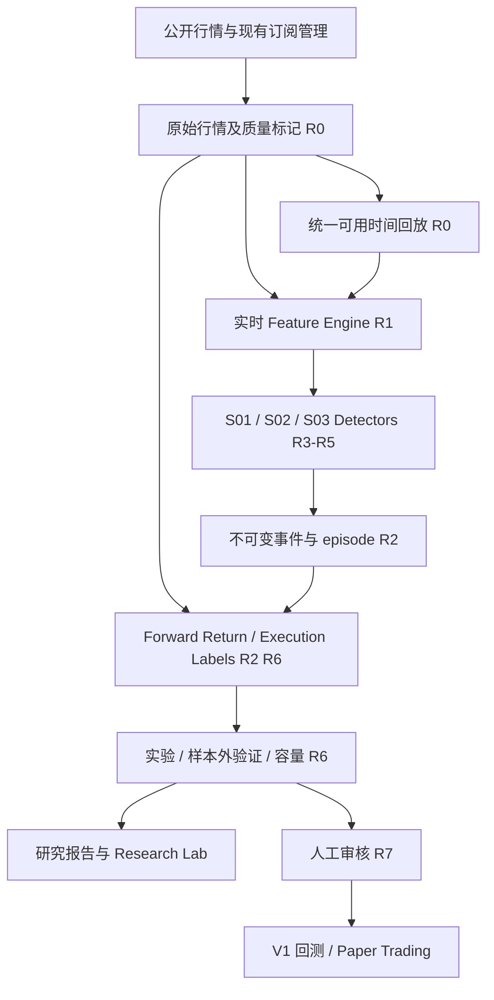
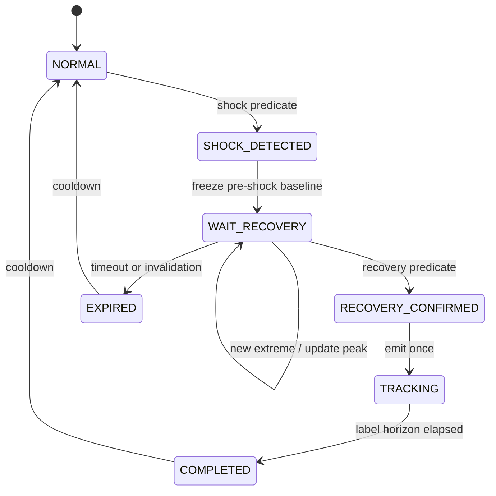

# Hyperliquid Quant Research Design V2

**版本：V2.0 | 状态：研究扩展实施规范 | 目标读者：Codex / 开发人员 | 2026-11-27**

## 1. 目标、范围及与 V1 的关系

本文件是 `doc/Hyperliquid_Quant_Design_v1.md` 的增量规范，不替换 V1。保留现有 M1–M5 平台路线、模块化单体架构、PostgreSQL/Parquet/DuckDB、Python/FastAPI、Vue 3/TypeScript、事件驱动策略及独立账户设计。新增 R0–R7 研究路线，目标是验证小资金、自动化、多市场、选择性参与是否具备扣除成本后的统计优势。

研究三个假设：S01 订单流持续性（顺势）；S02 流动性冲击与价格修复（逆势）；S03 多资产领先滞后（跨资产预测）。这些不是已验证盈利策略。小资金指订单相对双边可执行深度小，而非固定账户余额；自动化提供持续扫描与一致执行，不直接创造预测优势。容量曲线仅估计历史可见流动性下的执行能力，不能证明机构不参与或真实市场冲击为零。

首期仅原生 USDC 永续，使用公开主网行情。默认仅研究、不下单；不得接收私钥、签名、调用真实交易接口或自动晋级实盘。R7 只允许历史回测和实时模拟。M5 仍需独立授权。第一批实验使用 taker 模拟、确定性特征与线性模型；Maker、外部交易所、复杂 ML 暂缓。

### 1.1 当前已知基线与实施前检查

依据 2026-11-24 `PROGRESS.md`：M1 已有市场目录、观察池、七周期 K 线、资金费率、WS candle/BBO/trades、去重及缺口、手动 Parquet 归档、备份恢复；L2、自动清理、实验引用保护、迟到乱序监控未完成；M2/M3 当时仅预留接口。4,970 个 K 线任务中 4,847 个到期，需区分首次补齐和续采。此为历史报告，不代表当前代码状态。Codex 必须先审计实际代码、迁移、运行服务和最新进度，不重复实现已有功能，不覆盖用户数据，不停止正常采集。隔离测试数据库必须配置后实际跑集成测试，不能将跳过算通过。

### 1.2 规范用语

MUST/必须 = 验收条件；SHOULD/建议 = 可在记录理由后调整；所有阈值、仓位、样本量均为初始实验假设而非盈利承诺。以下 API 路径、表名、目录名为逻辑契约，可适配现有命名但须记录映射。公式内部收益统一使用小数（0.005 = 0.5% = 50 bps），时间 UTC 毫秒，金额 USDC，价格/数量/账本 Decimal 或 NUMERIC，统计 float64。配置必须带单位，禁止隐式百分比转换。

## 2. 架构与实施顺序



实时与回放共用特征、检测器、时钟及事件接口；研究标签不能流回在线检测器。采集 worker 不做模型训练、全市场矩阵或大范围扫描；独立 research worker / batch worker 使用有界队列、任务租约、取消、幂等重试；API 不阻塞采集。优先复用 `backend/app` 现有模块，不引入 Kafka、微服务或第二套行情库。

| 阶段 | 交付 | 依赖 |
|---|---|---|
| R0 | L2、双时间戳、质量、归档、确定性回放 | M1 |
| R1 | 公共 Feature Engine | R0 |
| R2 | 事件、标签、研究 API/UI、固定持有期模拟 | R0–R1 |
| R3 | S01 + 消融实验 | R1–R2 |
| R4 | S02 简化及完整状态机 | R0–R2 |
| R5 | S03 关系发现与在线检测 | R0–R2 |
| R6 | 容量、成本、统计验证、选币 | R2–R5，可提前提供公共能力 |
| R7 | 经审核的策略插件、账户回测及 paper | M2/M3、R6 |

**本次授权：R0–R3。** 同时尽早启动 R4 所需连续 L2 采集，预留 R4–R7 接口，不把未实现功能标成完成。M2/M3 可并行但不得因研究模块修改既有语义而破坏验收。若数据不足，先完成软件验收并显示研究样本不足。

## 3. R0 数据增强与采集

### 3.1 数据分层

| 层 | 初始范围 | 内容 |
|---|---|---|
| Tier 1 | 全部原生永续 | 现有市场快照、K 线、资产状态 |
| Tier 2 | 30–50 资产，先从现有稳定数量逐步扩容 | BBO、trades、1 秒特征 |
| Tier 3 | 10–20 资产，先小规模验证 | 连续 L2 快照与 Tier 2 全部内容 |

BTC、ETH、SOL、HYPE 可作为初始参考或基准资产，不强制作为领先资产。不同流动性区间均须覆盖；记录观察池历史、进入/退出时间、来源和规则版本。参考、研究、交易、持仓订阅分别引用计数。事件尚有标签待完成时保持必要订阅直到最长 horizon 或明确缺失；不得因退池静默丢失失败样本。L2 必须在冲击前持续采集，不可等事件出现再采集。

使用官方公开 WS trades、bbo、l2Book 等接口及当前资产状态源。实施前核对官方文档和实际消息 fixture，确认时间戳、成交主动方、资产标识、快照深度、频率、限额、价格数量精度；不要假设固定 5 Hz 或全深度。参考： https://hyperliquid.gitbook.io/hyperliquid-docs/for-developers/api/websocket/subscriptions 与 https://hyperliquid.gitbook.io/hyperliquid-docs/for-developers/api/rate-limits-and-user-limits 。如消息为有限档快照，不假装拥有完整订单簿；不从快照推断精确撤单和队列。第一期不要求增量盘口重建。记录实际接口版本与限制至实施日志。

### 3.2 原始数据与时间语义

| 逻辑实体 | 最小字段 |
|---|---|
| trade | exchange_id, asset_id, exchange_time(nullable), receive_time, ingest_seq, trade_id/source_key, aggressor_side, price, size, notional, connection_id |
| bbo | 公共字段、bid_price/size, ask_price/size, source_key |
| orderbook | 公共字段、bids/asks 数组(price,size,可用时订单数), snapshot_type, depth_limit, coverage_flags |
| asset_context | 公共字段、mark_price, oracle_price, open_interest, funding, available_time |
| funding settlement | asset_id, settlement_time, rate, source, available_time |
| gap | asset_id, stream, start/end, reason, connection_id, resolution |
| manifest | partition_id, schema_version, checksum, row_count, min/max time, source, file_path, status |

公共字段包含稳定资产 ID、来源及质量标记。保留原始精度，记录本地 receive_time（消息到达而非写库完成）及稳定 ingest_seq；available_time 是数据实际可以进入决策的时间，不早于 receive_time，派生特征不得早于全部输入可用时间。缺少交易所时间戳使用 null，不伪造。外部导入数据没有真实接收时间时标明 exchange-time-only，禁止与真实延迟回放混称。监控时钟偏差、消息延迟和处理延迟；WS 重连/缺口/重复/迟到/乱序单独计数。

### 3.3 回放规则

在线按可用时间和稳定序列处理，回放按 `(available_time, ingest_seq, source_key)` 重放同一输入；同一秒先处理截至 tick 可用的事件，再生成特征和信号，明确等时事件顺序。交易所事件窗口采用 `(t-w,t]`，只纳入 t 时已可用的数据；迟到消息可影响后续尚未结束窗口，但不得改写已发事件或过去特征。超出允许迟到范围标记并隔离；研究快照可重算为独立版本但不能冒充在线结果。缺失交易所时间的数据使用可用时间并标记。历史无 receive_time 的回放独立报告。

统一 1 秒 grid；S03 默认 5 秒采样，使用向过去 as-of join，不用未来插值。初始 BBO 最大 age 2 秒、L2 3 秒，可按实际采集频率配置；连接断开、crossed/invalid book、未预热、关键数据缺失均禁止相关检测。无成交且连接健康为零成交；连接缺口为未知。标签期数据缺失输出 missing/censored，不当成零收益。

### 3.4 存储与运行保障

复用 PostgreSQL 管业务元数据、任务、索引及热数据；原始高频行情按 UTC 日期/资产/流类型分区写 Parquet，DuckDB 查询。归档采用临时文件→校验行数、时间范围、checksum、回读→原子发布 manifest→事务更新状态→才允许清理热数据。实验通过 manifest pin 固定引用，禁止清理被引用分区；提供 dry-run、保留策略、失败恢复及审计。初始建议热数据 7 天、归档 90 天，均可配置，实际保留受磁盘及用户政策约束。默认禁止未经配置的永久删除。

磁盘阈值初始建议剩余 20% 告警、10% 停止非关键回补及新增高频订阅、5% 安全暂停高频采集并记录缺口；阈值须兼顾绝对剩余字节与 WAL/归档空间，恢复需滞回。优先保证现有持仓/关键状态与数据库完整性。区分回补 backlog 和实时续采；监控吞吐、队列丢弃、延迟 p50/p95/p99、WS 连接、限额、数据覆盖。先测 20 资产负载与至少 24 小时稳定性；未实际完成长时测试则标记 pending，不编造报告。

估算 L2 日原始字节 = 资产数 × 实测快照频率 × 平均字节 × 86400；压缩比、索引、WAL、备份另计。默认从 10 个 L2 资产开始，以实测资源扩容。

## 4. R1 公共特征计算引擎

### 4.1 数学定义

所有窗口仅使用当时可用数据，历史基准排除当前检测窗口。每个特征返回 value、valid、sample_count、coverage、as_of、version、quality_flags；无效值为 null，不能默认为 0。每资产滚动状态独立，重启从持久化 checkpoint 或历史预热恢复；版本变化须重新预热。

| 特征 | 定义与边界 |
|---|---|
| Mid | m=(ask+bid)/2，要求 0<bid<=ask |
| Spread_bps | 10000*(ask-bid)/m |
| Return(w) | ln(m(t)/m(t-w))，端点均要求新鲜报价 |
| V+、V- | 窗口内主动买、卖的 sum(price*size)，未知主动方单独计数，不归为卖方 |
| TFI(w) | (V+−V-)/(V++V-)；无成交无效 |
| CVD(w) | V+−V-，单位 USDC；可另提供按 episode 累计 |
| RVOL(w) | 当前 w 秒总成交额 / 历史非重叠 w 秒成交额中位数，排除当前窗口；零基准无效 |
| Persistence(d) | 最近 60s 分 12 个 5s 桶，方向一致的桶数/12；无成交不算一致 |
| Depth(delta) | 中间价上下 delta bps 内各侧 sum(price*size)，同时输出截断标记 |
| OBI(delta) | (D_bid−D_ask)/(D_bid+D_ask)，分母非零 |
| RobustSigma | 1.4826*median(abs(r−median(r))) |
| ShockZ | (r−median(r))/max(RobustSigma,epsilon) |
| Impact(w) | r(w)/((V+−V-)/ADV_1m)，分母过小无效；记录分母与符号 |
| OI change | OI(t)/OI(t-w)−1，保证单位相同且报价新鲜 |
| Market residual | r_i−alpha_i−beta_i*r_market，系数仅来自事件前训练数据 |

TFI、成交额、笔数、收益窗口 1/5/15/30/60/180s；RVOL 15/30/60s，历史基准 60min；深度/OBI 5/10/20/50/100bps；MAD 30/60min；价差滚动中位数及分位数；OI 1/5/15min；市场因子 5/15/30/60s。初始预热：至少 60min、历史桶覆盖率 >= 90%、方向未知成交金额占比 <= 5%、Persistence 至少 9 个有效成交桶；可配置。低波动保护 epsilon 初始 0.0001；不可用的特征不阻塞不依赖它的检测器。

盘口范围未被有限档快照覆盖时，深度为可见下界；不得把截断范围当完整市场深度。OBI 是静态盘口失衡，TFI 是实际主动成交失衡，OFI 是动态盘口事件失衡，三者不得混用。首期不实现精确撤单/队列 OFI。

### 4.2 逻辑接口（Python 伪代码）

```python
class FeatureEngine(Protocol):
    def on_event(self, event: MarketEvent) -> None: ...
    def snapshot(self, asset_id: str, as_of_ms: int) -> FeatureSnapshot: ...
    def reset(self, scope: str) -> None: ...

class Detector(Protocol):
    id: str
    version: str
    def on_tick(self, context: ResearchContext) -> list[ResearchEvent]: ...
    def checkpoint(self) -> dict: ...
    def restore(self, state: dict) -> None: ...
```

ResearchContext 只能访问 as_of 时刻可用的特征、配置、模型和质量信息；不暴露未来查询、账本写入或交易端口。实时与回放注入相同时钟、特征实现及配置。所有参数由 Pydantic schema 校验，提供 schema 给前端；非法窗口、负数、概率超界拒绝保存。

## 5. R2 通用事件研究引擎

### 5.1 事件与生命周期

事件不是交易订单。每个检测器独立启停、独立版本及参数组，可同时监控同一资产；禁止由单个检测器直接开仓。默认每秒评估，满足条件的 false→true 边沿生成事件；连续成立不逐秒重复触发。冷却期结束后仍须重新出现边沿或新 episode。记录所有候选、拒绝原因及最终确认；S02 的未确认、超时事件也保留。

```json
{
  "event_id": "deterministic-id",
  "run_id": "live-or-replay-run",
  "detector_id": "S01",
  "detector_version": "1.0.0",
  "parameter_hash": "sha256",
  "asset_id": "stable-id",
  "reference_asset_ids": [],
  "direction": "LONG",
  "detected_at_ms": 0,
  "available_at_ms": 0,
  "reference_mid": "100.00",
  "features": {},
  "quality_flags": [],
  "market_regime": "UNKNOWN",
  "liquidity_bucket": "UNKNOWN",
  "episode_id": "episode-id",
  "model_version": null,
  "universe_snapshot_id": "snapshot-id"
}
```

事件 ID 由 run/detector/version/config/asset/direction/trigger tick/episode 确定性生成，重试不重复写入。事件内容不可变；状态和未来标签分表追加。episode 初始按资产、方向及冷却窗口聚类，同一市场冲击可通过时间块与市场因子事件额外归组；不将跨币相关事件视为独立样本。事件状态：CANDIDATE、CONFIRMED、REJECTED、EXPIRED；标签状态独立 PENDING、COMPLETE、MISSING、CENSORED。实时标签任务须可重启并补算已到期 horizon。

### 5.2 ForwardReturnAnalyzer

默认 horizons = [5,15,30,60,180,300,900,1800] 秒，可加 3600。t0 为实际确认且可用的决策时刻，不是首次冲击或事后最低点。参考 mid 为 t0 时新鲜报价，未来 mid 使用 t0+h 时刻及之前最后有效报价；过期/断线则标签缺失。对方向 d=+1/-1，预测指标为 R(d,h)=d*ln(m(t0+h)/m(t0))。MFE=max(0,max R(d,u))、MAE=min(0,min R(d,u))，u∈[0,h]，记录首次达到时间、路径覆盖率、采样精度；只在覆盖率达标时使用完整路径指标。不得根据未来极值决定入场。

另生成可执行收益标签，初期以 BBO taker + 可配置额外滑点估计，明确 top-of-book 数量约束；大于可见数量时返回 insufficient_depth 或只记录部分成交，不假装无限深度。完整 L2 撮合见第9节。预测收益与执行收益分别报告，数据缺失和执行失败不得剔除后只报告成功样本。标签既支持实时到期计算，也支持历史批量计算，结果携带数据版本、模型及成本配置。

## 6. R3 / S01 订单流持续性

### 6.1 假设及触发

持续主动成交失衡可能导致后续方向性收益；也可能是趋势末端或对手方吸收。d=sign(TFI_15s)，分别检验多空；不得直接推断某机构身份或剩余订单。默认逻辑为所有必需条件 AND：

| 参数 | 默认值 | 候选值 |
|---|---|---|
| d*TFI_15s | >=0.5 | 0.3/0.5/0.7 |
| d*TFI_60s | >=0.3 | 0.2/0.3/0.5 |
| RVOL_30s | >=2 | 1.5/2/3/5 |
| Persistence_60s | >=0.75 | 0.60/0.75/0.90 |
| d*Return_60s | [0.0005,0.008] | 分箱研究 |
| Spread_bps | <=8 | 3/5/8/15 |
| Trades_30s | >=20 | 10/20/50 |
| 冷却期 | 60s | 30/60/180 |

此外必须通过通用预热、报价年龄及质量门槛。另保存 Impact、OBI、OI、回调特征；L2 是增强项，S01 无 L2 时仍可生成预测事件，但容量验证须标为受限。大幅上涨或强买入却不涨的样本可作为对照组，不能事后删除。

```python
if quality_ok and warmup_ok and not cooling_down:
    d = sign(tfi15)
    eligible = (d != 0 and d*tfi15 >= .5 and d*tfi60 >= .3
                and rvol30 >= 2 and persistence(d) >= .75
                and .0005 <= d*r60 <= .008
                and spread_bps <= 8 and trades30 >= 20)
    if eligible and not previous_eligible_for_direction[d]:
        emit_event(direction=d)
```

实际实现应在 cooldown 内仍维护边沿状态，且对 null 特征安全处理。参数候选非全笛卡尔积强制搜索；预先登记实验组，控制多重比较。

### 6.2 实验及后续策略候选

A：价格动量；B：A+TFI；C：B+RVOL；D：C+Persistence；E：D+OBI/Impact（有数据时）。在同一时间段、同一资产池和数据质量条件下比较；另报告各组样本量差异与匹配对照（时段、资产、波动、流动性）。首先比较固定未来周期，不优化止盈止损。按 TFI、RVOL、价格响应、流动性、市场状态分箱，报告均值/中位数/分位数/置信区间。

R7 候选：A 固定持有；B TFI 衰减或反向退出；C 回调确认；D 后续突破及跟踪止盈。B 的初始候选为 d*TFI_15s <0.1 连续 3 个评估 tick 或反向 TFI <=−0.3；仅待检验。统一保护性止损、最大持仓时间、异常行情退出及 V1 风控；本次不开发正式下单策略。

## 7. R4 / S02 流动性冲击与价格修复

### 7.1 因子、冲击及恢复特征

使用 BBO mid，先估计目标资产的市场残差收益 r_i−alpha−beta*r_M。初始市场因子 BTC，训练采用过去 24h 的非重叠 15s 有效收益（可配置，至少 500 样本），每小时更新；训练末尾不晚于当前冲击前，记录系数及版本。MAD/中位数使用同尺度历史残差窗口，排除当前冲击。原始收益 Z 与残差 Z 分别记录。目标为 BTC 时采用预先指定的其他参考因子或独立研究组，不重复自身因子。

对下跌冲击 s=−1、预期修复方向 d=+1；上涨完全镜像。D_pre 为冲击前 30s 有效盘口深度中位数（排除冲击窗口），D_post 为检测时同侧深度；Depletion=1−D_post/D_pre。下跌研究 bid 深度，上涨研究 ask 深度。同时记录当前 mid 相对范围及冲击前固定价格范围，防止移动范围造成伪恢复。固定范围覆盖不足返回 invalid，不要求价格变化后旧价格区间仍完全可见。盘口减少可来自成交或撤单，不将其直接归因于成交。

Decay=1−当前5s冲击方向主动成交额速率/自冲击起已观察到的最高5s速率；Recovery_D=D_current/D_pre；Recovery_S=Spread_current/Spread_normal，正常价差用冲击前30s中位数。需报价仍健康、有效成交及恢复证据，静默不等于压力衰减。

### 7.2 状态机



默认冲击检测：15s；|残差 Z|>=4、|残差收益|>=0.005、冲击方向与原始收益符号一致；RVOL_15s>=3；s*TFI_15s>=0.6；完整模型 Depletion>=0.4（20bps 同侧相对深度）。冻结 P0=m(t_shock−15s)、冲击前基准及因子版本；滚动更新已观察极值 P_extreme、成交速率峰值。恢复阶段最多120s，从首次冲击确认开始计时，不因新极值无限延长。新同向冲击重置恢复连续计数；反向冲击、关键数据缺失、市场共同剧烈波动则失效并记录理由。

恢复确认初始条件：Decay>=0.7、d*TFI_5s>d*TFI_15s、Recovery_D>=0.6、Recovery_S<=2、Spread_bps<=8、已发生方向修复且尚有剩余空间；连续 3 个有效秒 tick 确认。研究参数：冲击窗口 5/15/30/60s；Z 3/4/5；幅度 0.003/0.005/0.01；RVOL 2/3/5；TFI 0.4/0.6/0.8；消耗 0.3/0.4/0.6；衰减 0.5/0.7/0.85；深度恢复 0.4/0.6/0.8；价差比 1.5/2/3；等待 30/60/120/300s。市场共同剧烈波动的初始保护阈值：参考资产同窗口绝对收益超过其历史 4σ 且与冲击同向；作为独立过滤开关及消融变量。

### 7.3 修复比例与实验

下跌：rho=(P_t−P_extreme)/(P0−P_extreme)；上涨：rho=(P_extreme−P_t)/(P_extreme−P0)。分母须正。初始确认要求 0<rho<0.75；确认时冻结 P_extreme 与 P0，用其计算未来25/50/75/100%修复目标是否触及、首次触及时间及再次穿越极值概率。若入场时已超过某目标，该目标不计为未来成功。固定窗口收益仍以确认时刻为起点。执行可行性以可执行 bid/ask 单独计算，不用 mid 触及代替成交。

A 异常价格；B +成交量；C +市场残差；D +卖压/买压衰减；E +L2 深度和价差恢复。简化版 S02-BBO 不声称观测了深度消耗与恢复；完整 S02-L2 必须采集冲击前盘口。分别报告确认率、超时率、失败率、确认延迟与剩余修复空间，不只报告已确认赢家。

R7 候选退出：固定时间、修复比例、重新冲击/保护止损。暂不以事后最低价入场，不根据未来路径调整冲击锚点。

## 8. R5 / S03 多币种领先滞后

### 8.1 离线关系发现

BBO mid 统一 5s grid，r_i(t)=ln(m_i(t)/m_i(t−Δ))。C_AB(k)=Corr(r_A(t),r_B(t+kΔ))，k>0 表示 A 领先 B；同时测试负滞后与零滞后。禁止将相关性当因果。剔除过期报价、断线及不可比采样，记录有效配对样本数；禁止未来插值及使用最新成交价作为主价格。比较 exchange-time-only 和实际 receive-time 回放，识别传输延迟造成的假滞后。

初始候选领先窗口 5/15/30/60s，预测 horizon 5/15/30/60/180s，训练窗口 7/14/30 天，默认 14 天；候选滞后 5–100s（5s 步长）。按小时或日批处理，默认每日刷新，候选关系有效期 24h，数据缺失或模型失效立即停用。起步以 BTC/ETH/SOL/HYPE 等高流动性参考资产对研究池扫描，再扩展全池有向关系；N 个资产有 N(N−1) 对，计算必须分块、向量化、限并发。

### 8.2 两个独立预测模型

模型 A：直接未来收益预测。

- 基准：r_B(t,t+h)=alpha+phi*r_B(t−w,t)+gamma*r_M(t−w,t)+error。
- 增强：基准 + beta*r_A(t−w,t)。
- 使用训练数据拟合 OLS（必要时预先规定 ridge），固定特征缩放参数；A 为市场因子时从基准中排除重复项，另选参考或单独比较。
- 对比样本外 MAE/MSE、方向准确率、预测分箱校准及净可执行收益。训练样本标签必须在模型发布前成熟，保留训练截止时间、模型发布时间和配置哈希。

模型 B：价格传导缺口。以领先资产冲击起点 t_s 为共同锚点，拟合历史相同事件截至 h 的总传导系数 beta，而不是直接复用模型 A 的未来收益系数。Gap=beta*r_A(t_s,t)−r_B(t_s,t)，预测方向 sign(Gap)，记录缺口与未来实际修复比例；可为负 beta。锚点必须在当时可见，冲击事件只允许一次触发，避免逐秒重叠。

### 8.3 在线检测初始契约

关系须处于 active、模型未过期、训练和验证记录完整；A/B 均新鲜且时间对齐，目标价差 <=8bps，过去窗口无断线。领先冲击初始条件 |r_A(w)|>=0.003 且 |Z_A|>=3，候选 0.002/0.003/0.005、Z 2/3/4。A 模型取预测值方向，|预测收益| >= 预估往返成本 + 0.001；B 模型独立使用 |Gap| >= max(0.002, 成本+0.001) 并记录该缺口不是预测期望。冷却期默认 max(60s,h)，同一目标多个领先信号分别记录，研究统计以 episode 聚类；实际账户冲突交 R7 处理。

关系初选可用 |滞后相关|>=0.1、至少 1000 对有效样本、至少 3 个不同日期且正滞后峰稳定作为探索条件；不得以此直接判定盈利。发布 active 前须在验证集证明增强模型相对基准具有改善，并通过多重检验控制及成本评估；无足够历史数据则关系为 provisional，不发布正式交易候选。失效条件包括到期、系数符号不稳、验证性能不再优于基准或数据质量异常。重新训练不修改旧实验。

分钟级 K 线实验独立命名 S03-1m，仅用已闭合 K 线，不能替代秒级可交易验证；不得从 K 线伪造 BBO/trades/L2。

## 9. R6 执行成本、容量与小资金筛选

### 9.1 统一 taker 执行模型

预测研究使用 mid 对数收益，账户收益使用实际模拟成交价与数量。入场时刻为 t0+entry_delay，退出为 t0+h+exit_delay；h<=entry_delay 时该档无效。回放在各执行时刻仅使用当时可用且未过期的报价/盘口；以固定数量 q（由目标名义金额 Q 与入场参考价换算并按交易所规则取整）沿对手方档位逐级撮合，计算 VWAP=sum(p*q_fill)/sum(q_fill)。多单入场买 ask、退出卖 bid，空单反之；退出使用实际入场成交数量，不重新按 Q 计算数量。

默认立即成交或取消的模拟语义，记录未成交、部分成交、剩余仓位及最大允许价格偏离。深度不足不可填造价格；固定 horizon 标签可报告完整成交子集，但必须同时报告尝试总数、失败率和未平剩余数量，不能将退出失败当成零损失或已平仓。完整账户模式继续管理未平仓位。额外滑点仅表示盘口外的保守执行误差，不重复计入已反映在 VWAP 的价差与扫档。手续费按各腿实际名义成交额乘配置费率计算；资金费率按持仓经过的结算点和方向计入，缺失时明确标注不完整。费率由实际市场规则核对、配置并版本化，不硬编码为永远有效的当前费率。

净利润（USDC）= d*q*(P_exit−P_entry)−fee_entry−fee_exit+net_funding；净收益率以入场成交名义金额为分母，未完成平仓不输出完整实现收益。账本与统计用相同成交记录。额外报告 mid→VWAP 成本、延迟 markout 与手续费各项，不二次扣费。

### 9.2 容量实验

对固定的事件集合分别测试 Q=[20,50,100,250,500,1000,5000,10000,50000] USDC 与 entry/exit delay=[0,100,300,500,1000,3000,5000] ms，首期可分批而非全组合。0ms 仅理论基准；实际延迟分布由服务实测，记录网络与处理延迟。测试订单规格、最小金额、价格/数量精度；不合法标记 invalid。L2 有限档覆盖外不外推，静态回放无法模拟自身冲击引起的市场反馈，结果为容量估计而非真实可执行保证。

输出每档尝试数、完整开平仓率、部分成交率、开/平仓滑点 p50/p95、净收益分布、利润金额、深度占用、持仓时间、不可执行原因、置信区间。对完整成交子集与共同可成交子集分别报告，不以不同样本构造虚假容量曲线。资金效率 = 净利润 / sum(实际占用资金×持仓小时)，明确资金定义和未平仓处理。

### 9.3 SmallCapitalSelector

Q 为用户配置单笔名义金额，初始 100 USDC；U=Q/min(D_bid,D_ask)，默认 20bps 深度。U<=0.05 为探索低占用，0.05–0.15 进一步检查，>0.15 初始排除交易候选；无 L2 则标记未知，不能声称已通过。结合价差、深度稳定性、成交额、活跃度与历史可见数据覆盖；研究池仍保留不适合交易的对照资产。按历史流动性分位数分 L1–L5，版本化边界，不使用未来排名；L5 默认仅观察。定期重算，复用 M1 排名缓冲、最短保留、池容量及黑名单机制。

## 10. 实验流程与统计验收

E1 事件研究：不下单，记录所有候选及结果；E2 条件分组/消融；E3 容量与延迟压力；E4 V1 完整账户回测；E5 参数冻结实时 paper。E1–E3 可独立于 M2/M3，E4/E5 依赖 V1 账户与执行模块。各策略独立模拟账户，S00 EMA/简单动量作为参考；固定初始资金、风险预算、资产池和成本配置公平比较，组合账户另行研究。

实验必须持久化 detector/feature/model 版本、参数哈希、数据 manifest、观察池历史、训练验证测试区间、代码版本或源文件 hash、随机种子、成本及延迟模型、排除原因、运行日志与结果。固定输入重复运行结果一致；随机 bootstrap 固定种子。数据覆盖不足时报告 INSUFFICIENT_DATA，不伪造回测。

按时间顺序 60/20/20 初始切分，训练发现关系、验证选参数、测试仅最终评估；跨边界未来标签 purge，隔离期至少最大标签 horizon，依据特征窗口和重叠事件进一步加长；模型更新采用滚动向前训练，禁止使用未成熟标签。S03 大量关系搜索采用 FDR 控制（初始 BH q=0.05，依赖结构不满足时采用更保守方法），候选与实际检验族预登记。记录全部试验，不只保留赢家。按 episode 或时间块 bootstrap（初始 2000 次，块长至少最大 horizon 并根据相关性调整），输出 95% CI 与有效样本量；相关事件不能当独立样本。

报告：事件总数/有效数/缺失数、独立 episode 数、各 horizon 的均值中位数分位数、方向胜率、MFE/MAE、达到目标概率、净收益/成本、PF（无亏损分母为零时标记未定义或无穷而非随意填值）、回撤（仅完整权益曲线）、流动性/资产/时间/方向分组。每个热力图单元显示样本数与 CI；样本少于 100 为探索性，100–500 初步，500–2000 系统验证候选，以上仅经验分级而非统计显著性保证。

人工晋级参考：样本外平均净收益>0，优先 CI 下界>0；PF 初始目标>1.2；合理延迟和更高成本压力下仍具研究价值；相邻参数稳定；不过度依赖单一币/单日；目标订单规模具备成交能力；风险预算内回撤；冻结参数实时模拟与历史预期相容。没有满足条件的策略是合法研究结果。不得自动晋级实盘，亦不得把正收益的工程测试 fixture 当盈利证据。

## 11. 逻辑存储模型

复用现有资产、行情、任务、归档及账户表，按迁移增量添加：

| 实体 | 关键字段及约束 |
|---|---|
| research_detector_config | id/version、参数 JSON、hash、enabled、pool、created_at；配置版本不可变 |
| research_run | id、mode、config hash、status、clock、manifest refs、cursor、lease、error |
| research_event | event_id PK、run_id、detector/config、asset/direction、times、episode、features JSON、quality、model ref |
| research_event_transition | event_id、seq、state、time、reason；唯一(event_id,seq) |
| research_forward_label | event_id、horizon、label_version、mid returns、MFE/MAE、coverage、status；组合唯一 |
| research_execution_label | event_id、horizon、Q、delay config、execution version、fill status、VWAP、cost、net；组合唯一 |
| research_model | model_id、A/B、type、coefficients、train cutoff、published_at、expires_at、metrics、status |
| research_experiment | id、spec、data pins、code hash、seed、split、status、progress、result ref |
| research_episode | episode_id、asset/market group、start/end、关联事件 |
| feature_checkpoint | scope、version、cursor、state ref、updated_at |

时间/asset/run/detector 索引、唯一约束、外键按实际规模设计。高频 feature 序列可用 Parquet，PostgreSQL 保留查询索引和事件特征快照。禁止标签更新事件特征；删除实验必须解除引用而非直接删除共享行情。分页、范围限制、查询超时；禁止一次加载全量高频数据到 API 内存。

## 12. API 与前端 Research Lab

路径建议 `/api/research`，遵循项目既有 API envelope、错误格式及鉴权（如已有）。

| 方法/路径 | 功能 |
|---|---|
| GET /detectors | 注册检测器、schema、版本、依赖和启停状态 |
| POST /configs | 校验并创建不可变配置版本 |
| POST /runs | 启动实时研究或历史回放，预检数据和池 |
| GET /runs/{id} | 状态、进度、覆盖率、错误 |
| POST /runs/{id}/stop | 幂等停止/取消，不删除历史记录 |
| GET /events | 按资产、方向、检测器、时间、状态、episode 分页 |
| GET /events/{id} | 特征、状态变化、标签、执行估计 |
| GET /events/{id}/replay | 有界前后时间范围的 trades/BBO/L2/features |
| GET /forward-returns | 按 horizon/group 聚合及样本数/CI |
| POST /experiments | 创建异步实验及参数组 |
| GET /experiments/{id} | 任务进度、结果、数据引用 |
| GET /models | S03 候选关系及有效期（R5） |
| GET /capacity | 容量曲线与执行失败率（R6） |

WS 推送研究事件摘要、任务进度及质量告警，重连后 REST 补齐；不将全部原始行情推给浏览器。未交付路由明确 unavailable，不返回虚构数据。

前端新增一级 Research Lab，保持现有 Markets/Watchlist/System 等页面。R0–R3 最小 UI：采集质量及 L2 覆盖、检测器配置/启动停止、事件列表、事件详情、未来收益曲线、S01 消融实验及任务状态。事件详情与 K 线联动，显示触发时间、参考价、方向、TFI/RVOL/价差、原始成交与盘口（如有）、拒绝理由、标签待完成/缺失状态。后续 R4 加冲击状态机和修复图，R5 加领先滞后矩阵和关系详情，R6 加容量曲线、参数热图、样本外报告及 CSV 导出。界面固定 RESEARCH MODE 或 PAPER MODE 标识；任何示例数据只在 fixture/demo 模式显示并明确标注。

## 13. 自动化验收用例

| ID | 阶段 | 必须验证 |
|---|---|---|
| T-R01 | R0 | 实际 WS L2 fixture 解析；bid/ask 正确、价格数量精度、有限档标记、资产 ID 正确 |
| T-R02 | R0 | 重复/乱序/迟到/断线不污染已发信号；过期报价失效；receive time 不伪造 |
| T-R03 | R0 | 实时记录回放相同事件顺序，原始与归档回读一致；实验 pin 阻止清理 |
| T-R04 | R0 | 模拟磁盘告警及保护、限流、积压、任务恢复；20 资产实际负载报告 |
| T-R05 | R1 | 手算 trades：主动买 75、卖25 USDC，TFI=0.5；无成交 invalid；RVOL=3 等固定 fixture |
| T-R06 | R1 | mid/spread/深度/OBI/MAD/窗口边界正确；历史基准排除当前窗口；零分母安全 |
| T-R07 | R1 | 未来或迟到数据注入不修改此前特征；重启预热与 checkpoint 恢复一致 |
| T-R08 | R2 | 相同 tick 重试不重复事件；边沿、冷却和 episode 归组正确 |
| T-R09 | R2 | 人工路径验证 long/short forward return、MFE/MAE、目标到期；缺失不能记零 |
| T-R10 | R2 | 标签任务重启恢复；历史与实时检测共用实现，在线无未来标签访问 |
| T-R11 | R3 | S01 多空镜像、每项阈值边界、弱成交、未知方向、追涨及冷却过滤 |
| T-R12 | R3 | A–D 消融使用一致区间及记录样本差异；真实行情至少跑一次完整事件扫描和报告，允许零事件 |
| T-R13 | R4 | 合成冲击→恢复、再次冲击、超时、系统性下跌过滤；禁止事后极值入场 |
| T-R14 | R4 | 无 L2 不得输出完整恢复指标；固定范围覆盖不足标记无效 |
| T-R15 | R5 | 合成已知滞后关系可识别正确方向；同步、陈旧成交价、共同因子假关系被对照识别 |
| T-R16 | R5 | 训练截止早于发布，无未来标签；关系过期停用；无数据不发布 active |
| T-R17 | R6 | 合成 L2 逐档 VWAP、双向 PnL、费用、资金费率、部分成交及退出失败 |
| T-R18 | R6 | 延迟使用正确时间盘口；深度不足不外推；固定事件集合容量报告 |
| T-R19 | R6 | 时间切分 purge、bootstrap 可复现、FDR、样本不足状态、分组 CI |
| T-R20 | 全部 | V1 M1 回归、隔离数据库迁移/集成测试、前端类型检查/构建及 E2E、无实盘调用 |

至少增加一个从原始 fixture → 特征 → S01 事件 → 标签 → API → 页面端到端用例，并运行真实公开行情 smoke test。合成测试可确保触发条件被覆盖，真实市场测试只确认链路与数据，不要求人为制造真实盈利事件。真实扫描样本数量、覆盖时间、有效/无效事件、测试失败及跳过必须如实报告。

## 14. Codex 实施指令与交付清单

1. 阅读本文件、V1 及最新 PROGRESS.md，审计实际实现。将冲突、版本、目录及可复用模块写入 `doc/RESEARCH_IMPLEMENTATION_PLAN.md`；保留现有数据与迁移。
2. 按 R0→R1→R2→R3 实际编码，每阶段先定义契约及测试，再实现、迁移、启动和验收。尽早启用小规模连续 L2 采集；若磁盘或 API 限额不足，记录并降低规模，不阻塞现有 M1。
3. R0–R3 完成时提供可配置的 Research Lab、真实行情事件扫描、固定 horizon 标签、S01 基准消融和初步 BBO 成本估计；R4–R7 保留清晰接口与待办，禁止显示假完成。
4. 更新 `PROGRESS.md` 和 `doc/RESEARCH_PROGRESS.md`，逐项标记 implemented/tested/pending/blocked；记录运行命令、依赖锁、迁移号、测试数、跳过理由、实际数据覆盖、磁盘及性能测量。24h 稳定性测试若尚未完成，明确待验收。
5. 不提交私钥、真实账户凭据或原始大数据；不得执行真实订单。不要自动将研究参数变为交易配置，不覆盖 V1 文档，不为追求漂亮结果修改历史数据或测试标准。
6. 验收交付：代码、增量迁移、配置样例、测试 fixture、README 启动说明、实际测试报告、研究实验报告样例（真实数据不足则明确），以及下一阶段 R4 的数据准备情况。

本规范的成功标准不是立即找到盈利策略，而是使任何假设都能够被可重复、可信、扣除成本的实验检验。
